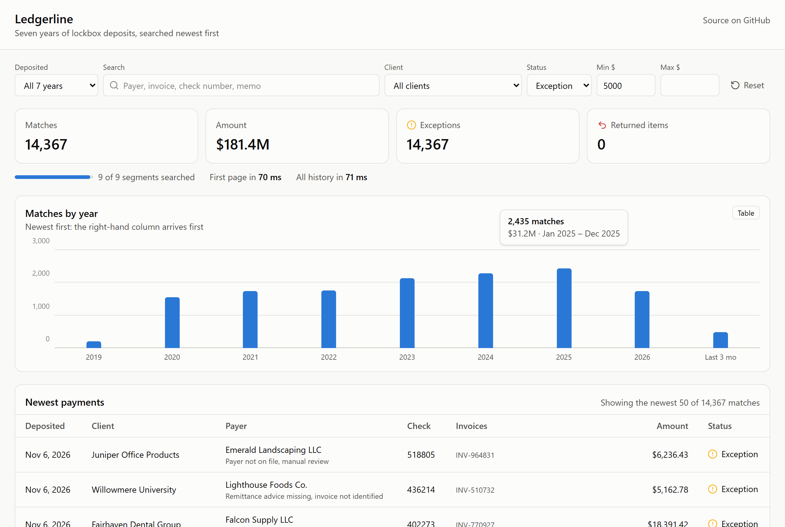

# Ledgerline

Fast search over years of lockbox payments. An ASP.NET Core API over Elasticsearch
that answers the first page from the hot tier in milliseconds and streams the rest
of the answer to a React UI over Server-Sent Events while cold history is searched.



> Work in progress. See the milestones below.

## The problem

A treasury client asks: *"Show me every check from Acme Supply over $5,000 in the
last seven years."* The data is years of lockbox deposits: one index per month,
most of it old and rarely read. A single query across all of it makes the person
wait for the slowest, coldest shard before they see anything.

## The idea

Results are sorted newest first. So if the **hot tier** (the last three months)
already holds a full page of matches, that page is the **exact** first page of the
whole answer, because every cold document is older. Ledgerline:

1. searches the hot tier and streams page 1 at once,
2. counts all of cold history in one request alongside it, broken down by year,
   and streams those totals (count, sum, status breakdown) newest year first,
3. stops early when the person cancels or changes the query.

The baseline, one query across every index, is kept as an endpoint so the
difference is [measured](#results) rather than claimed. At 20 million payments
with 16 to 64 concurrent users, page 1 arrives **1.9–6.3× sooner** at the
median (1.3–3.1× at p95) and the cluster serves **30–40% more searches per
second**. Needle queries are the exception, and the results say so.

## Stack

| Part | Tech |
| --- | --- |
| API | C# / ASP.NET Core (.NET 10), minimal APIs, Server-Sent Events |
| Search | Elasticsearch 9 (monthly indices, hot and cold tiers) via `Elastic.Clients.Elasticsearch` |
| Seeder | .NET console app: deterministic synthetic lockbox payments, bulk indexed |
| Portal | React 19 + TypeScript + Vite + Tailwind 4, served by nginx |
| Tests | xUnit v3; integration tests against a real Elasticsearch, checked against LINQ over the same data |

## Milestones

- [x] 1. **Index and seed**: index template, monthly indices, hot/cold tiers, deterministic seeder, baseline search endpoint
- [x] 2. **Two-phase streamed search**: hot page first, cold years streamed over SSE, cancellation
- [x] 3. **Search portal**: React UI with filters, skeletons and live totals
- [x] 4. **Measured**: baseline vs two-phase, time to first result and p95 under load
- [ ] 5. **Public demo**

## How the data is laid out

- **One index per deposit month** (`payments-2026.11`), created from a strict
  [index template](src/Ledgerline.Search/payments-template.json). Each index is
  sorted by deposit date, newest first.
- **Hot tier**: the newest three months. Still written to, refreshed every second.
- **Cold tier**: everything older. Made read-only and force-merged to a single
  segment once loaded, which keeps years of rarely-read history cheap to store
  and search.
- **Synthetic payments**: 30 treasury clients, thousands of payers, log-normal
  amounts around $1,800, about 95.5% posted, 3.5% exceptions and 1% returned
  items. Volume grows over time. Each month is generated from its own seed, so
  the data is identical on every machine and re-seeding overwrites by id.

## Run it

Only Docker is needed:

```sh
docker compose up -d --wait
```

Open **http://localhost:8080**. The first start builds the images and seeds
2,000,000 payments (about a minute; set `SEED_COUNT` for more or fewer). The
API answers at `http://localhost:8080/v1/...` behind the same nginx.

### From source

Needs the [.NET 10 SDK](https://dotnet.microsoft.com/download) and Node 24.

```sh
docker compose up -d elasticsearch                        # Elasticsearch on localhost:9200
dotnet run -c Release --project src/Ledgerline.Seeder     # 2,000,000 payments, about a minute
dotnet run -c Release --project src/Ledgerline.Api        # http://localhost:5000
cd web && npm install && npm run dev                      # portal on http://127.0.0.1:5173
```

The seeder takes `--count`, `--today` and `--parallel`. A month counts as
complete once it is sealed, so re-running skips finished months and rebuilds
only missing or interrupted ones; searches keep working while it runs.

```sh
curl 'localhost:5000/v1/search?text=INV-244258'
curl 'localhost:5000/v1/search?client=Meridian%20Freight%20Lines&min=5000&status=exception&from=2021-01-01'
```

| Parameter | Meaning |
| --- | --- |
| `text` | Free text over payer, memo, invoice, check number and lockbox |
| `client` | Treasury client, exact name |
| `status` | `posted`, `exception` or `returned` |
| `min`, `max` | Amount range in dollars |
| `from`, `to` | Deposit date range, `YYYY-MM-DD` |
| `size` | Page size, 0 to 200 (default 50) |

## The portal

- **Filters in one row**, date range first (presets or a custom range), then
  free text, client, status and amount. They are kept in the address bar, so a
  search can be bookmarked or shared.
- **Totals that grow as each year reports**, with the time to the first page
  and to all history, measured in the browser.
- **Matches by year**, one column per segment with the hot tier on the right.
  The chart fills in right to left as the stream reports newest first; years
  not searched yet pulse at the baseline. Every column has a hover and keyboard
  tooltip with its date span, and a table view holds every value.
- **The newest page of payments.** Status is an icon plus a label, never color
  alone. Skeleton rows appear only on the very first search; changing a filter
  dims the previous results until the new page arrives instead of flashing.
- Changing a filter closes the stream, which cancels the years still to search.
  The stream is also closed on `done`, because a browser's `EventSource`
  otherwise reconnects and silently runs the whole search again.

## Streamed search

`GET /v1/search/stream` takes the same parameters and answers in stages over
[Server-Sent Events](https://html.spec.whatwg.org/multipage/server-sent-events.html):

```text
$ curl -N 'localhost:5000/v1/search/stream?status=returned&min=2000'

event: plan        {"segments":[{"label":"hot",...},{"label":"2026",...}, ... {"label":"2019",...}]}
event: page        {"hits":[...50 newest...], "complete":true, "at_ms":15}
event: progress    {"segment":"hot",  "segment_totals":{"count":302,...}, "running":{"count":302,...},  "searched":1, "segments":9}
event: progress    {"segment":"2026", "segment_totals":{"count":1129,...},"running":{"count":1431,...}, "searched":2, "segments":9}
...
event: progress    {"segment":"2019", ...                                  "running":{"count":9368,...}, "searched":9, "segments":9}
event: done        {"totals":{"count":9368, "amount":69027222.04, ...}, "first_page_ms":15, "at_ms":33}
```

| Event | When | Meaning |
| --- | --- | --- |
| `plan` | first | The segments that will be searched, in the order their progress will arrive. |
| `page` | as soon as there is something to show | The first page so far, newest first; replaces any earlier `page`. `complete: true` means no later segment can change it. |
| `progress` | after each segment | That segment's totals and the running totals. Segments are the hot tier, then each cold year, newest first. |
| `done` | at the end | Final totals, equal to what `/v1/search` returns for the same filters. |
| `error` | if a segment fails mid-stream | The stream ends here; filters are validated before it starts, so bad input is still a `400`. |

How it works:

- **Page 1 is exact early.** If the hot tier has a full page of matches, nothing
  older can displace it, so it is sent while cold history is still being counted.
- **Cold history is counted, not paged.** One request aggregates per-year
  buckets only (`size: 0`; overall totals are their sum) and is broken down into
  one `progress` event per year, newest first.
- **A short page is topped up separately.** When the hot tier has fewer matches
  than a page, a page-only request (no totals, no aggregations) fetches exactly
  the missing rows from all cold history, and the page is sent as soon as it
  returns, without waiting for the counts.
- **Cold searches are rationed.** At most `COLD_CONCURRENCY` (default 16) cold
  requests run at once across all users; hot-tier searches are never held back,
  so first pages do not queue behind counting under load.
- **Closing the connection stops the work.** Searches in flight are cancelled.

The original design, one request per cold year, three at a time, is still
available as `?cold=years` for comparison; [Results](#results) shows why it is
not the default.

Tests check that, for several kinds of query (hot-heavy, rare, all-cold, free
text, no matches) and both strategies, the streamed page and totals, and each
year's totals, equal plain searches exactly.

## Results

Measured on one laptop (20 logical CPUs, NVMe SSD) with the whole stack in
Docker: a single-node Elasticsearch 9.5.5 with a 2 GB heap, the API and nginx.
The [benchmark tool](src/Ledgerline.Bench/Program.cs) times requests through
nginx as a browser would, over seven queries from broad ("everything") to a
needle (one 2021 invoice number). Raw numbers: [`docs/bench`](docs/bench).

Two baselines, because the stream delivers more than a plain search:

- **Plain**: `/v1/search`, page and totals in one request.
- **Fair**: `/v1/search?years=true`, the same page, totals *and* per-year
  breakdown the stream delivers, in one request. Two-phase is compared to this.

"Page" is the first *exact* page (identical to the baseline's), not an earlier
partial one; "complete" is when every total has arrived.

### 20 million payments (3.3 GB), under load

| | Searches/s | Page p50 | Page p95 | Complete p50 | Complete p95 |
| --- | ---: | ---: | ---: | ---: | ---: |
| 16 users, fair baseline | 166 | 88 ms | 161 ms | 88 ms | 161 ms |
| 16 users, **two-phase** | **236** | **46 ms** | **122 ms** | **61 ms** | **123 ms** |
| 16 users, per-year (`cold=years`) | 95 | 59 ms | 192 ms | 150 ms | 305 ms |
| 64 users, fair baseline | 178 | 376 ms | 492 ms | 376 ms | 492 ms |
| 64 users, **two-phase** | **231** | **60 ms** | **157 ms** | **275 ms** | **344 ms** |
| 64 users, per-year (`cold=years`) | 94 | 60 ms | 732 ms | 692 ms | 982 ms |

At this size two-phase also serves **more** searches: the baseline sorts a page
out of all 20 million documents, while the cold request only counts.

### 20 million payments, one user, caches dropped before every request

Elasticsearch's caches cleared and the page cache of Docker's VM dropped
before each request (p50 of 5 runs).

| Query | Matches | Fair baseline | Two-phase page | Two-phase complete |
| --- | ---: | ---: | ---: | ---: |
| Everything, newest first | 20,000,000 | 171 ms | **41 ms** | 162 ms |
| One client over $5,000 | 881,813 | 46 ms | **15 ms** | 38 ms |
| Free text "Supply" | 3,037,377 | 54 ms | **19 ms** | 49 ms |
| Exceptions over $5,000 | 145,072 | 36 ms | **13 ms** | 32 ms |
| Returned items over $20,000 | 5,441 | 23 ms | **11 ms** | 26 ms |
| Needle: one 2021 invoice | 35 | 26 ms | 29 ms | 29 ms |
| Only 2021 (no hot tier) | 2,342,595 | 27 ms | **15 ms** | 30 ms |

**Where it does not help: needle queries.** When almost nothing matches in the
hot tier, the page needs cold history anyway, and two-phase pays for the hot
search, a page query and the counts: 29 ms against 26 ms (and 20 ms for the
plain search without a per-year breakdown).

### 2 million payments (304 MB)

At this size the data is small enough that cold and warm caches measure the
same, and 64 users saturate the laptop: two-phase gets page 1 out **3.9×
sooner** at the median (53 against 205 ms) and **2.2×** at p95 (130 against
283 ms), but serves 15% fewer searches than the fair baseline and its complete
p95 is 15% slower. Full tables: [`docs/bench/2m`](docs/bench/2m).

### How the design got here

The first version streamed one request per cold year, and the first load test
showed it serving **40% fewer searches** than a single query. Each fix was
measured before the next:

1. **Fewer requests barely helped.** One request for all cold years with a
   per-year `date_histogram` went from 250 to 257 searches/s.
2. **Profiling each request shape inside Elasticsearch** found the real cost:
   the cold request aggregated every document twice (per year *and* overall)
   and sorted a page the hot tier had usually filled. Counting only per-year
   buckets and fetching no page brought hot plus cold to about the cost of one
   request with the same breakdown.
3. **Under saturation, first pages queued behind counting.** Capping concurrent
   cold searches (admission control) took page p95 at 64 users from worse than
   the baseline to better; a cap of 4 was too strict, 16 was right here.
4. **At 20 million payments** the same design serves more searches than the
   baseline, not fewer.

### Reproduce

```sh
SEED_COUNT=20000000 docker compose up -d --wait   # or the default 2,000,000
dotnet run -c Release --project src/Ledgerline.Bench -- warm --runs 20
dotnet run -c Release --project src/Ledgerline.Bench -- cold --runs 5     # needs Docker; drops caches
dotnet run -c Release --project src/Ledgerline.Bench -- load --users 64 --seconds 30
```

The seeder keeps completed months, so changing `SEED_COUNT` needs a fresh
volume (`docker compose down -v`).

## Develop

```sh
dotnet test                 # API, search and seeder
cd web && npm test          # portal: stream reducer, filters, formatting
```

Unit tests always run. Integration tests seed 20,000 payments under their own
`payments-test-` prefix, so they never touch seeded data, and compare every
search with the same payments filtered in memory. Without a running cluster
they are skipped; CI sets `REQUIRE_ELASTICSEARCH=1` so they fail instead.

## License

MIT
